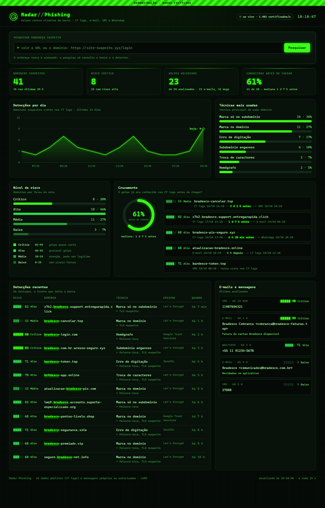
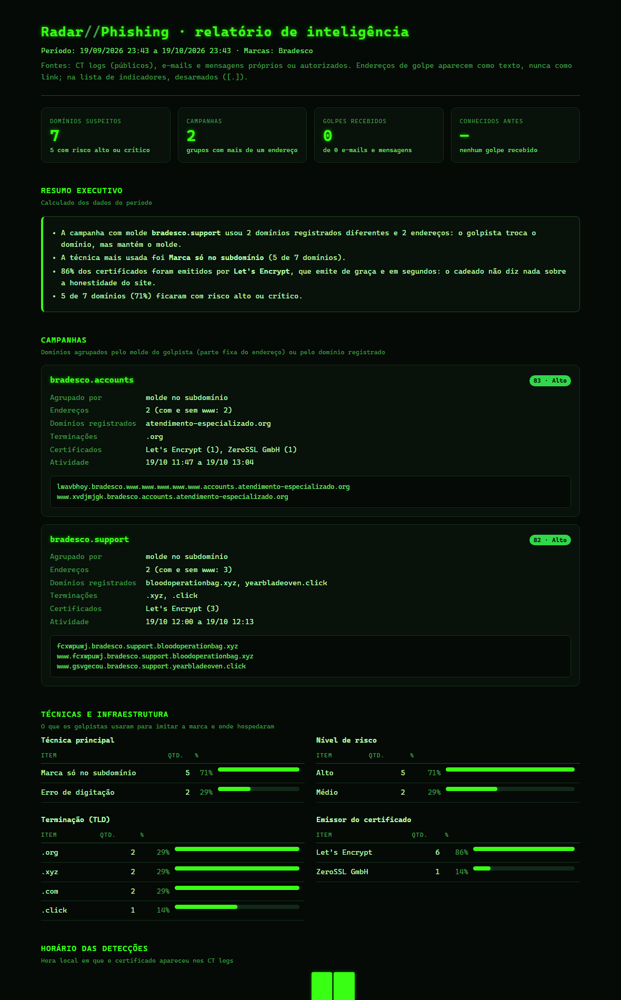
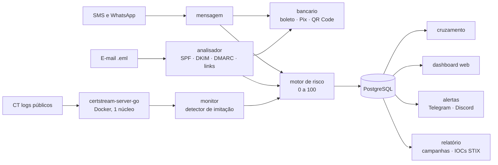
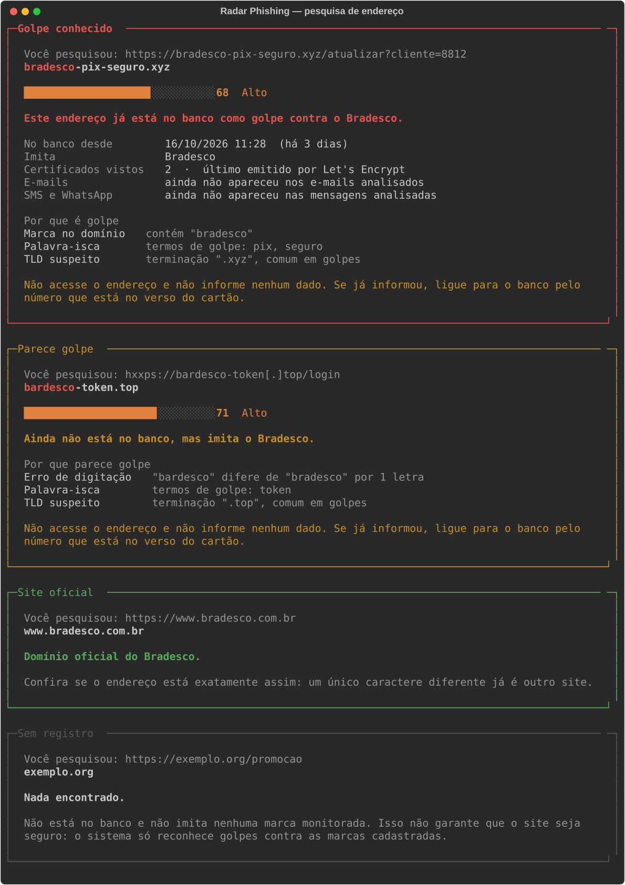
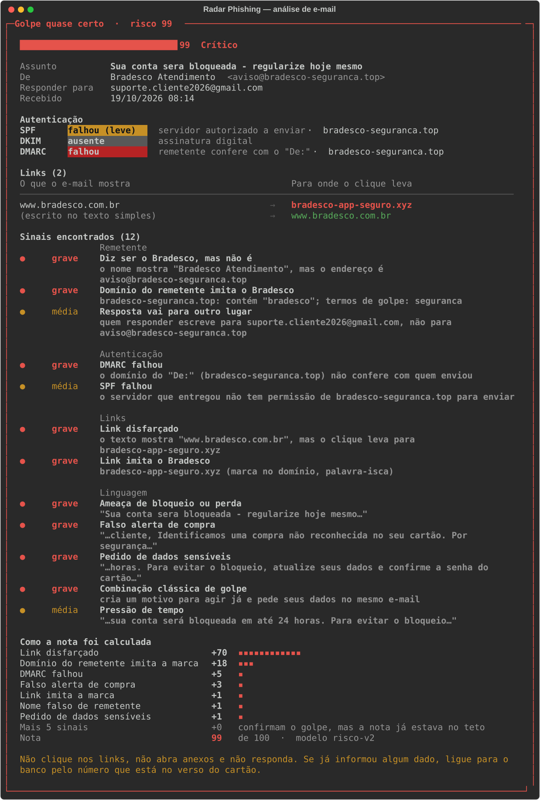
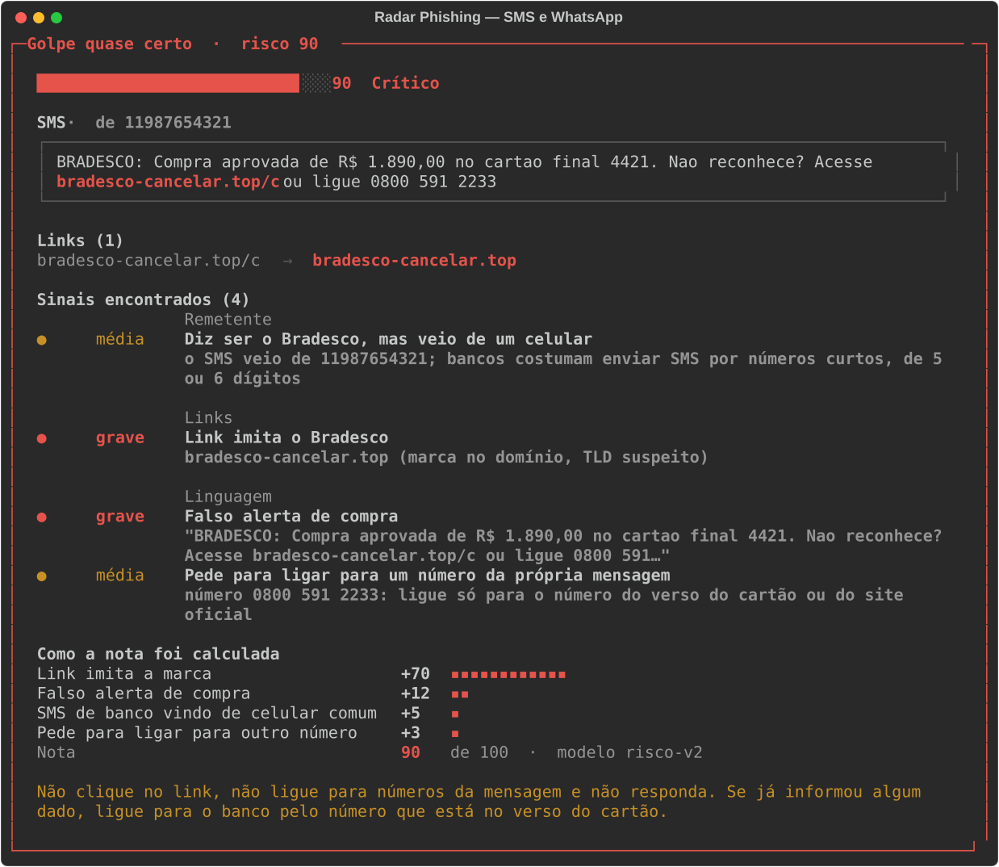
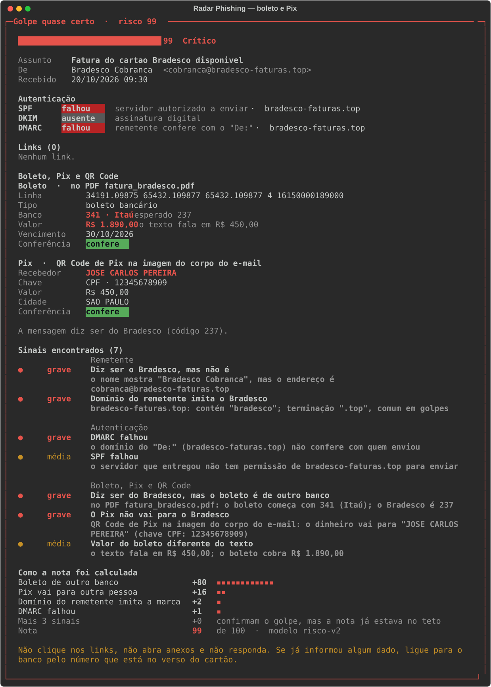
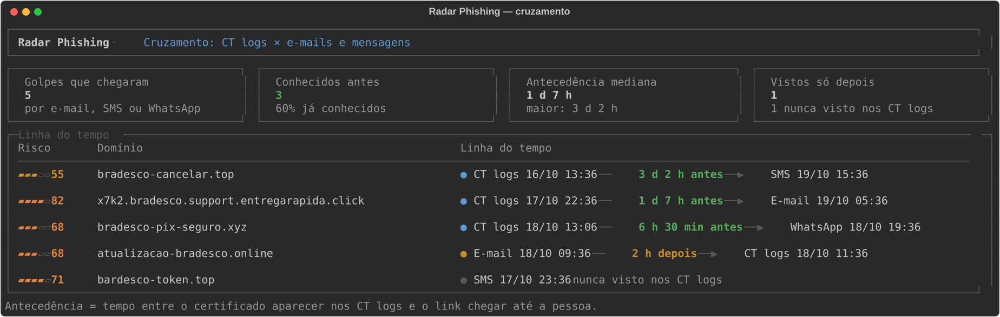
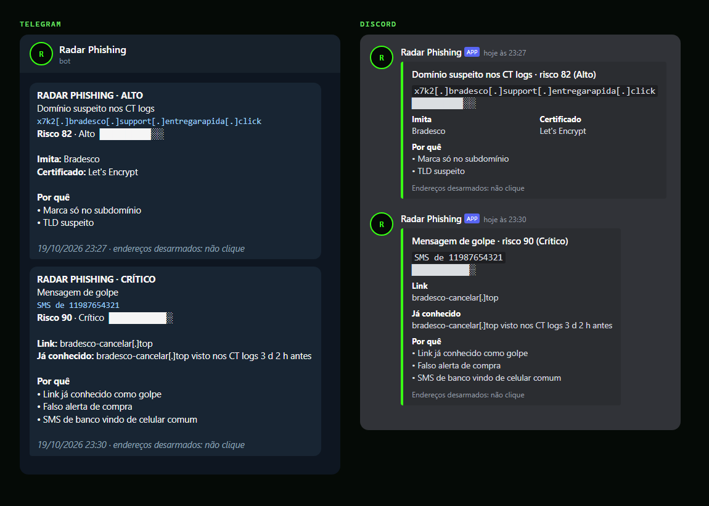

# Radar Phishing

Detector de golpes de phishing contra clientes de bancos brasileiros. Vigia o
nascimento de sites falsos nos registros públicos de certificados HTTPS (CT
logs), analisa e-mails, SMS e WhatsApp suspeitos, confere boletos e códigos
Pix, dá a cada ameaça uma nota de 0 a 100 com os motivos e mostra quando um
golpe já era conhecido **antes** de chegar até a pessoa.

`Python 3.13` · `PostgreSQL 16` · `Docker` · `FastAPI` · `STIX 2.1` · 150 testes automáticos



*Dashboard no modo demonstração (`python -m dashboard --demo`): dados fictícios.*

---

## Em números

Resultado real das primeiras horas com o monitor ligado (19/10/2026):

| | |
|---|---|
| Certificados analisados | ~1.400 por segundo, num único núcleo |
| Domínios suspeitos | 7, sendo 5 com risco alto |
| Campanhas identificadas | 2: `bradesco.support` (2 domínios registrados, `.xyz` e `.click`) e `bradesco.accounts` |
| Emissor dos certificados | 86% Let's Encrypt: o cadeado não diz nada sobre a honestidade do site |
| Falsos positivos | 2 encontrados nos dados reais e corrigidos no detector (uma empresa inglesa de aquecedores) |



---

## O que ele faz

| Frente | O que detecta |
|---|---|
| **Monitor de domínios** | Sites que imitam o banco no momento em que ganham certificado: marca no domínio, só no subdomínio, homógrafo (letra cirílica), troca de caracteres (`br4desco`), erro de digitação (`bardesco`) |
| **E-mail** | SPF, DKIM (verificação criptográfica) e DMARC; link que mostra um site e leva a outro; remetente falso; linguagem de golpe; anexo executável disfarçado |
| **SMS e WhatsApp** | Falso alerta de compra, golpe do falso parente, falsa central, link sem `http://` |
| **Boleto e Pix** | Linha digitável adulterada (dígitos de conferência FEBRABAN), boleto de outro banco, Pix que vai para uma pessoa física, QR Code escondido em imagem ou PDF |
| **Motor de risco** | Nota de 0 a 100 que soma os sinais como chances independentes e mostra quantos pontos cada um somou |
| **Cruzamento** | Quanto tempo antes o monitor já conhecia o site que chegou por e-mail ou SMS |
| **Dashboard, alertas e relatório** | Painel web, aviso no Telegram ou Discord e relatório de inteligência com campanhas e indicadores em STIX 2.1 |

**Ética e LGPD.** Usa apenas dados públicos (CT logs) e mensagens próprias ou
autorizadas. O corpo de e-mails e o texto de mensagens nunca são gravados.
Nenhum link suspeito é aberto: tudo é analisado a partir do endereço, do
certificado e do conteúdo da mensagem.

---

## Arquitetura



| Pasta | Conteúdo |
|---|---|
| `monitor/` | leitura dos CT logs, detector, painel ao vivo e pesquisa de URL |
| `analisador/` | análise de e-mail (autenticação, remetente, links, linguagem, anexos) |
| `mensagem/` | análise de SMS e WhatsApp |
| `bancario/` | boleto (FEBRABAN), Pix (BR Code do Banco Central) e QR Code |
| `risco/` | modelo de risco, pesos e reavaliação do histórico |
| `cruzamento/` | antecedência entre CT logs e mensagens |
| `dashboard/` | servidor FastAPI e página web |
| `alertas/` | Telegram e Discord |
| `relatorio/` | relatório de inteligência e exportação de IOCs |
| `sql/` | esquema do banco, uma migração por etapa |
| `tests/` | 150 testes, com exemplos fictícios em `tests/exemplos/` |

---

## Roteiro

| Etapa | Entrega | Peso | Status |
|---|---|---|---|
| 0 | Fundação: estrutura, banco e esquema | 5% | concluída |
| 1 | Monitor de domínios (CT logs + detecção de imitação) + pesquisa de URL | 17% | concluída |
| 2 | Analisador de e-mails (SPF/DKIM/DMARC, links, urgência) | 17% | concluída |
| 3 | Motor de risco 0–100 com motivos | 12% | concluída |
| 4 | Golpes brasileiros: SMS/WhatsApp, boleto falso, QR Code de Pix | 15% | concluída |
| 5 | Cruzamento: site detectado antes do e-mail | 7% | concluída |
| 6 | Dashboard web | 11% | concluída |
| 7 | Alertas no Telegram ou Discord | 4% | concluída |
| 8 | Relatórios de inteligência (campanhas, IOCs) e documentação final | 12% | concluída |

A etapa 4 entrou depois do plano original. A sandbox para abrir links, que
estava no plano, saiu do escopo; o peso dela foi redistribuído entre
relatórios, dashboard e cruzamento.

---
## Como rodar

```bash
copy .env.example .env          # e preencha POSTGRES_PASSWORD com uma senha longa
docker compose up -d --wait
python -m venv .venv
.venv\Scripts\pip install -r requirements.txt
.venv\Scripts\python -m monitor
```

- O banco sobe na porta **5433** (a 5432 é do honeypot-analytics), aceitando só
  conexões do próprio computador (`127.0.0.1`). A senha fica só no `.env`.
- `python -m monitor pesquisar` abre a caixa de pesquisa de endereços (ver abaixo).
- `python -m monitor testar DOMINIO` explica o veredito para um domínio avulso.
- `python -m analisador ARQUIVO.eml` analisa um e-mail salvo (ou uma pasta de .eml).
- `python -m mensagem` analisa um SMS ou WhatsApp colado.
- `python -m bancario boleto|pix|qrcode ...` confere um boleto, um Pix ou um QR Code avulso.
- `python -m dashboard` abre o dashboard em http://127.0.0.1:8765 (`--demo` usa dados fictícios).
- `python -m cruzamento` mostra quais golpes o monitor já conhecia antes de chegarem.
- `python -m alertas` avisa no Telegram ou Discord (`simular` mostra sem enviar).
- `python -m relatorio` gera o relatório de inteligência e os IOCs (CSV e STIX 2.1).
- `python -m risco pesos` mostra a tabela de pesos; `python -m risco reavaliar` recalcula tudo.
- `python -m pytest` roda todos os testes.
- `docker compose stop` desliga tudo e libera a memória.

Banco criado antes das etapas 1 a 8? Aplique as migrações uma vez:

```bash
docker exec -i radar_db psql -U analista -d radar < sql/03_monitor_dominios.sql
docker exec -i radar_db psql -U analista -d radar < sql/04_analisador_emails.sql
docker exec -i radar_db psql -U analista -d radar < sql/05_motor_de_risco.sql
docker exec -i radar_db psql -U analista -d radar < sql/06_golpes_brasileiros.sql
docker exec -i radar_db psql -U analista -d radar < sql/07_cruzamento.sql
docker exec -i radar_db psql -U analista -d radar < sql/08_batimento_monitor.sql
docker exec -i radar_db psql -U analista -d radar < sql/09_alertas.sql
```

---

## Monitor de domínios

### De onde vêm os dados

Toda autoridade certificadora publica cada certificado HTTPS que emite em logs
públicos e auditáveis (Certificate Transparency). Um golpista que quer o
cadeado no site falso precisa de um certificado, e no momento em que o pede o
domínio aparece nos logs, muitas vezes antes de o site estar no ar.

O antigo servidor público do CertStream não entrega mais dados, então o
projeto roda o seu próprio (`certstream-server-go`, serviço `certstream` no
`docker-compose.yml`). Ele lê os logs do Google, Cloudflare, Let's Encrypt e
outros e repassa cada certificado por WebSocket.

### Custo na máquina

Medido num Ryzen 5 7520U (4 núcleos):

| Peça | CPU | RAM |
|---|---|---|
| Servidor CertStream, limitado a 1 núcleo | 1 núcleo (12% da máquina) | ~150 MB |
| Monitor em Python (painel + detector) | ~33% de 1 núcleo | ~45 MB |
| PostgreSQL | ~0% em repouso | ~50 MB |

Sem o limite, o servidor chegou a usar mais de 3 núcleos. Com o limite, ele
repassa cerca de 1.400 certificados/s (80% do volume total); como cada
certificado é publicado em 2 ou mais logs, a perda real é menor.

### Como um domínio é julgado

O detector (`monitor/detector.py`) é feito só de funções puras, testadas em
`tests/`. Antes de procurar a marca, o domínio passa por três camadas de
normalização (`monitor/normalizacao.py`): punycode para Unicode, letras de
outros alfabetos para latinas e leet para letras (0→o, rn→m...).

| Técnica | Exemplo | Sozinha marca? |
|---|---|---|
| Subdomínio enganoso | `bradesco.com.br.acesso-seguro.xyz` | sim |
| Homógrafo | `brаdesco-login.com` (com "а" cirílico) | sim |
| Troca de caracteres | `br4desco-app.online` | sim |
| Erro de digitação | `bardesco-token.top` | sim |
| Marca no domínio | `atualizacao-bradesco-pix.com` | sim |
| Palavra-isca | seguranca, token, pix, login... | não, só reforça |
| TLD suspeito | .xyz, .top, .online... | não, só reforça |

Domínios oficiais (`marca.dominios_oficiais`) nunca são acusados.

**Erro de digitação sem pesar na máquina.** Comparar cada pedaço de cada
domínio com a marca letra a letra seria caro demais para ~1.400
certificados/s. Antes, um filtro barato descarta quase tudo: uma única letra
errada altera no máximo 3 trigramas de "bradesco", então um parecido de
verdade ainda divide pelo menos 2 trigramas com a marca. Só esses poucos
passam pelo cálculo de distância (Damerau-Levenshtein). Resultado medido:
8.384 domínios/s num único núcleo.

### O que fica no banco

| Tabela / visão | Conteúdo |
|---|---|
| `dominio` | o domínio suspeito e a marca que ele imita |
| `certificado` | cada emissão vista (emissor, data, log CT, serial) |
| `deteccao_dominio` | técnicas, motivos em JSON e o trecho que imita a marca |
| `vw_dominios_suspeitos` | tudo junto, do mais recente para o mais antigo |

```sql
SELECT dominio, tecnicas, detectado_em FROM vw_dominios_suspeitos LIMIT 20;
```

### Pesquisa de endereço

Cole a URL ou o domínio de um link suspeito e o sistema diz se ele já está no
banco. O endereço **nunca é acessado**: a pesquisa só lê o texto e consulta o
PostgreSQL.

```bash
.venv\Scripts\python -m monitor pesquisar                                   # caixa de pesquisa
.venv\Scripts\python -m monitor pesquisar "https://site-suspeito.xyz/login"  # direto
```

Aceita URL completa, domínio solto, porta, usuário na URL e a notação
"desarmada" usada por analistas (`hxxps://site[.]xyz`).

| Resultado | Quando |
|---|---|
| Golpe conhecido | o domínio está no banco |
| Subdomínio de golpe conhecido | `login.golpe.xyz` quando `golpe.xyz` está no banco |
| Parece golpe | não está no banco, mas o detector acusa na hora |
| Site oficial | domínio oficial da marca |
| Sem registro | nada encontrado, com o aviso de que isso não garante segurança |



Na etapa 6 a mesma pesquisa ganha uma caixa no dashboard web.

### Limitações conhecidas

- Domínio que imita a marca **sem** citar o nome (ex.: `seguranca-cliente-app.com`)
  passa despercebido aqui. A etapa 2 o pega quando ele chegar por e-mail.
- Leet e combinações (rn→m, cl→d) podem gerar leituras estranhas em domínios
  legítimos; por isso só contam quando reconstroem uma palavra da marca.
- Com o servidor limitado a 1 núcleo, uma parte dos certificados nos picos é
  descartada.

---

## Analisador de e-mails

```bash
.venv\Scripts\python -m analisador mensagem.eml
.venv\Scripts\python -m analisador pasta-com-emails\
.venv\Scripts\python -m analisador tests\exemplos --nao-gravar   # os 3 exemplos fictícios
```

Para salvar um e-mail como `.eml`: no Gmail, abra a mensagem › três pontinhos ›
**Fazer download da mensagem**; no Outlook, arraste a mensagem para uma pasta.
Só analise e-mails seus ou que alguém autorizou.



### As cinco frentes

| Frente | O que procura | Módulo |
|---|---|---|
| Remetente | nome que diz "Bradesco" com endereço de outro lugar, domínio que imita a marca, resposta desviada para outro endereço, endereço oficial usado sem autenticação | `remetente.py` |
| Autenticação | SPF, DKIM e DMARC; política DMARC publicada pelo domínio | `autenticacao.py` |
| Links | texto que mostra um site e leva a outro, `@` enganoso, IP, encurtador, punycode, domínio que imita a marca | `links.py` |
| Linguagem | pressão de tempo, ameaça de bloqueio, promessa de prêmio, pedido de dados | `linguagem.py` |
| Anexos | programas (`.exe`, `.js`, `.lnk`...) e extensão dupla (`fatura.pdf.exe`) | `analise.py` |

Cada sinal tem gravidade (grave, média, leve) e a evidência concreta. A nota
de 0 a 100 é da etapa 3.

### De onde vem cada resultado de autenticação

- **SPF**: só o servidor que recebeu o e-mail sabe qual IP o entregou, então o
  resultado vem do cabeçalho `Authentication-Results` que ele escreveu.
  O sistema lê **apenas o primeiro** desses cabeçalhos: os de baixo podem ter
  sido escritos pelo golpista. O exemplo `golpe_falsifica_oficial.eml` tem um
  cabeçalho forjado dizendo "passou em tudo", e ele é ignorado.
- **DKIM**: verificado aqui mesmo com `dkimpy`, que busca a chave pública no
  DNS e confere a assinatura. Sem rede, usa o resultado do servidor de
  recebimento. O teste `test_dkim_verificado_de_verdade_e_adulteracao_detectada`
  assina um e-mail com uma chave gerada na hora, muda uma palavra e confirma
  que a assinatura passa a falhar.
- **DMARC**: usa o resultado do servidor de recebimento; sem ele, calcula o
  alinhamento e consulta a política publicada em `_dmarc.<domínio>`. O
  `bradesco.com.br` publica `p=reject`: pede que e-mails falsos sejam recusados.

### Privacidade (LGPD)

O corpo do e-mail é lido para a análise, mas **nunca é gravado**. No banco
ficam remetente, assunto, resultados de autenticação, links e sinais. O
arquivo é identificado pelo hash SHA-256: analisar o mesmo arquivo de novo
atualiza a linha, sem duplicar.

```sql
SELECT recebido_em, remetente, assunto, sinais, sinais_graves FROM vw_emails_analisados;
```

### Limitações conhecidas

- Frases de golpe são procuradas por padrões em português. Um texto bem
  escrito, sem as palavras típicas, passa por esta frente; as outras quatro
  continuam valendo.
- O dicionário de domínios organizacionais é simplificado (cobre `.com.br`,
  `.co.uk` e afins); casos raros de sufixo público podem errar o alinhamento
  quando não há `Authentication-Results`.
- Ainda não lê a caixa de entrada direto (IMAP): o e-mail precisa ser salvo
  como `.eml`.
---

## Motor de risco

Cada sinal, de domínio ou de e-mail, tem um peso de 0 a 100: o quanto ele,
sozinho, indica golpe. Os pesos ficam todos em `risco/modelo.py`, com o
raciocínio ao lado, e podem ser vistos com `python -m risco pesos`.

**Como os sinais se combinam.** Como chances independentes:

```
nota = 100 × (1 − (1 − p1) × (1 − p2) × … × (1 − pn))
```

Sinais de 40 e 30 dão `100 × (1 − 0,6 × 0,7) = 58`. A nota só sobe quando um
sinal entra, nunca passa de 100, e vários sinais fracos não equivalem a um
forte.

**Mesma prova não conta duas vezes.** "Link disfarçado" e "link imita a
marca" quase sempre falam do mesmo link. Por isso, a partir do segundo sinal
da mesma família, o peso vale metade.

**Teto em 99.** Nenhum conjunto de sinais é certeza absoluta.

| Nota | Nível |
|---|---|
| 0–29 | Baixo |
| 30–59 | Médio |
| 60–84 | Alto |
| 85–99 | Crítico |

A explicação mostra quantos pontos cada sinal somou; a soma é a nota.

| Exemplo | Nota |
|---|---|
| `bradesco-noticias.com.br` (só cita o banco) | 40 · Médio |
| `bardesco-token.top` | 71 · Alto |
| `fcxwpuwj.bradesco.support.bloodoperationbag.xyz` (real, 19/10/2026) | 82 · Alto |
| `brаdesco-login.com` (homógrafo) | 90 · Crítico |
| e-mails de golpe dos exemplos | 99 · Crítico |
| e-mail legítimo dos exemplos | 0 · Baixo |

### Histórico e reavaliação

Cada avaliação é uma linha em `avaliacao_risco`, com a versão do modelo; uma
linha nova só entra quando a nota muda. `vw_risco_atual` mostra a mais
recente de cada domínio e e-mail.

Quando o detector ou os pesos mudam, `python -m risco reavaliar` reaplica
tudo ao que já está no banco. Na primeira execução, com os dados reais de
19/10/2026, ela:

- removeu 2 falsos positivos (`bladescommercialwaterheaters.co.uk`, uma
  empresa inglesa de aquecedores: "bladesco" está a 1 letra de "bradesco");
- acrescentou a técnica "marca só no subdomínio" aos 4 golpes reais, que
  subiram para 82 e 83.

Domínio e certificados de um falso positivo ficam no banco (são fatos); só a
acusação é removida.
---

## Golpes brasileiros: SMS, WhatsApp, boleto e Pix

No Brasil a maior parte dos golpes contra cliente de banco não chega por
e-mail, e boa parte não depende de link: o dinheiro sai por um boleto
adulterado ou por um Pix para a pessoa errada.

### SMS e WhatsApp

```bash
.venv\Scripts\python -m mensagem                       # caixa para colar a mensagem
.venv\Scripts\python -m mensagem "texto" --de 27888    # direto
```



A mensagem passa pelas peças que já existiam (detector de domínios, linguagem,
motor de risco) e por sinais próprios:

| Sinal | Exemplo |
|---|---|
| Falso alerta de compra | "Compra aprovada de R$ 1.890. Não reconhece?" |
| Golpe do falso parente | "Mudei de número, salva esse aqui" |
| Pedido de Pix | "Me passa um Pix?" |
| Pede para ligar para outro número | "Ligue 0800 ..." (golpe da falsa central) |
| SMS de banco vindo de celular comum | bancos costumam usar números curtos |
| Link já conhecido como golpe | o monitor já tinha visto o domínio nos CT logs |

Links sem `http://` (`bradesco-cancelar.top/c`) também contam, desde que
terminem em um TLD conhecido: assim "Sr.Joao" não vira link. O texto da
mensagem **nunca é gravado** (LGPD); ficam o hash, o canal, os links e os sinais.

### Boleto falso

O sistema encontra a linha digitável no texto ou **dentro do PDF anexo** e
confere com as regras da FEBRABAN:

- **dígitos de conferência**: módulo 10 em cada campo e módulo 11 no geral.
  Trocar um único dígito nos três primeiros campos é sempre detectado;
- **banco**: um "boleto do Bradesco" tem de começar com 237;
- **valor**: comparado com o valor que a mensagem promete, e não com o do PDF,
  que o golpista deixa coerente com o boleto falso;
- **vencimento**: o fator de vencimento chegou em 9999 em 21/02/2025 e voltou
  para 1000; o sistema trata as duas eras.

Também confere contas de consumo e tributos (48 dígitos, começando com 8).

### QR Code e Pix

QR Codes são lidos de imagens no corpo do e-mail e de PDFs anexos, porque
filtros de e-mail não leem imagem e golpistas usam isso. O conteúdo de um QR
Code de Pix (BR Code do Banco Central) é aberto campo a campo: recebedor,
chave, valor, cidade e a conferência CRC16.



O sinal mais forte é **"o Pix não vai para o banco"**: o e-mail diz
"pague sua fatura do Bradesco", mas o recebedor no próprio código é uma pessoa
física.

```bash
.venv\Scripts\python -m bancario boleto "23791.23454 67890.123457 67890.123457 6 16150000189000"
.venv\Scripts\python -m bancario pix "00020126...6304ABCD"
.venv\Scripts\python -m bancario qrcode imagem.png
```

Nenhum arquivo é aberto por programa externo e nenhum link é acessado: imagem
e PDF são lidos em memória, com limite de tamanho contra "bombas" de
descompressão.

### Exemplos e testes

`scripts/gerar_exemplos_bancarios.py` gera os exemplos fictícios
(`tests/exemplos/golpe_boleto_pix.eml`, `boleto_legitimo.eml`,
`qrcode_link.png`). O cálculo do CRC do Pix é conferido contra o valor de
referência publicado do algoritmo (CRC-16/CCITT-FALSE de "123456789" = 29B1).

Falso positivo corrigido durante o desenvolvimento: o SMS legítimo
"seu código de segurança é 482913, não compartilhe" era acusado de pedir
dados. Agora só **pedir** o código conta; citá-lo, não.
---

## Cruzamento: o golpe já era conhecido antes de chegar?

É a pergunta que junta as duas frentes do projeto. O monitor vê o certificado
do site falso nascer nos CT logs; dias depois, o mesmo domínio chega num
e-mail, SMS ou WhatsApp. A **antecedência** é o tempo entre um e outro:
quanto antes um banco poderia ter bloqueado o site ou avisado os clientes.

```bash
.venv\Scripts\python -m cruzamento
```



*Dados fictícios, gerados por `scripts/previa_cruzamento.py` numa transação
desfeita no final.*

- Uma linha por (domínio suspeito, e-mail ou mensagem em que ele chegou), na
  visão `vw_cruzamento`.
- Situações: **antes** (o monitor já sabia), **depois** (o certificado só
  apareceu depois do e-mail) e **nunca visto** (o site não passou pelo
  monitor; por exemplo, estava fora do ar quando o monitor rodava).
- O golpista tira certificado para `golpe.xyz` e manda `login.golpe.xyz`: o
  certificado de um domínio "acima" também conta.
- Links oficiais do banco no rodapé do e-mail ficam de fora: só entram
  domínios que imitam uma marca.
- A data de chegada do e-mail vem do cabeçalho `Date`, que o remetente pode
  falsificar; sem ele, vale o momento da análise.

O mesmo cruzamento aparece no relatório de cada e-mail e mensagem: o sinal
"Link já conhecido como golpe" diz, por exemplo, *"o monitor já sabia 3 d 2 h
antes desta mensagem"*.

```sql
SELECT dominio, canal, situacao, antecedencia FROM vw_cruzamento;
```
---

## Dashboard web

```bash
.venv\Scripts\python -m dashboard          # dados reais: http://127.0.0.1:8765
.venv\Scripts\python -m dashboard --demo   # dados fictícios, com a faixa "demonstração"
```

Uma página que reúne tudo e se atualiza sozinha a cada 15 segundos: caixa de
pesquisa de URL, indicadores, detecções por dia, técnicas mais usadas, níveis
de risco, cruzamento com a antecedência e as últimas detecções, e-mails e
mensagens.

**Visual.** Verde neon sobre preto, com contraste conferido pela norma WCAG
(texto principal 17:1; o verde mais apagado, 5,9:1, acima do mínimo de 4,5:1).
Os quatro níveis de risco usam uma rampa de um só verde, do escuro ao neon,
com distância perceptual entre vizinhos acima de 11; cada nível também aparece
escrito, para a cor nunca ser a única pista. Gráficos em SVG desenhados à mão,
sem bibliotecas externas, com dica ao passar o mouse.

**Segurança**, por ser um painel de segurança:

- escuta só em `127.0.0.1`: nenhum outro aparelho da rede abre o dashboard;
- somente leitura: nenhuma rota grava no banco;
- a pesquisa nunca acessa o endereço pesquisado;
- `Content-Security-Policy` sem script ou estilo inline e sem nada de fora;
- todo dado do banco entra na página como texto (`textContent`), nunca como
  HTML: um domínio de golpe com nome malicioso não vira código;
- a documentação automática da FastAPI (`/docs`) fica desligada.

Os testes em `tests/test_dashboard.py` conferem cada um desses pontos.

**Monitor ao vivo.** O monitor grava um "batimento" a cada 10 segundos
(`monitor_batimento`). O status do topo vem dele, e não do último golpe
achado: um monitor saudável pode passar horas sem detectar nada.
---

## Alertas no Telegram e no Discord

```bash
.venv\Scripts\python -m alertas            # fica rodando: confere a cada 30 s
.venv\Scripts\python -m alertas simular    # mostra o que sairia agora, sem enviar
.venv\Scripts\python -m alertas teste      # manda um alerta de teste para os canais
```



*Prévia gerada por `scripts/previa_alertas.py`: o texto é o que o sistema
envia de verdade; a moldura do aplicativo é imitada.*

Avisa quando surge domínio, e-mail ou mensagem com risco **alto ou crítico**
(configurável). Para ligar, copie `.env.example` para `.env` e preencha o
token do bot do Telegram ou o webhook do Discord; o passo a passo está no
próprio arquivo. Sem canal configurado, roda em **modo simulação**: mostra
na tela e nada sai do computador.

Regras:

- **uma vez só**: cada alerta fica registrado na tabela `alerta` e não se repete;
- **sem enxurrada**: no máximo 20 por hora em cada canal (configurável);
- **sem despejar o histórico**: só avisa o que apareceu nas últimas 2 horas;
- se o canal pedir para esperar (HTTP 429), o ciclo para e tenta depois.

Segurança:

- endereços de golpe vão **desarmados** (`hxxps://golpe[.]top`): o alerta não
  vira o caminho para cair no próprio golpe;
- a chave do bot fica só no `.env` e nunca aparece em mensagem de erro: no
  Telegram ela faz parte do endereço, e o erro é registrado sem ele;
- todo dado é escapado antes de virar formatação no Telegram, e o Discord não
  menciona ninguém (`@everyone` vira texto);
- só é aceito webhook do próprio Discord: um endereço qualquer no `.env`
  mandaria os dados dos golpes para um servidor desconhecido.
---

## Relatório de inteligência

```bash
.venv\Scripts\python -m relatorio              # últimos 7 dias
.venv\Scripts\python -m relatorio --dias 30 --abrir
```

Gera, em `dados/relatorios/`, três arquivos:

- **o relatório** (HTML autocontido, sem script; ao imprimir ou salvar em PDF,
  troca o tema neon por preto no branco): resumo executivo calculado dos
  dados, campanhas, técnicas, infraestrutura (TLD e emissor do certificado),
  horário das detecções, sinais em e-mails e mensagens, indicadores e
  limitações;
- **os indicadores em CSV**, com o domínio cru e desarmado;
- **os indicadores em STIX 2.1**, o formato padrão para trocar inteligência
  de ameaças: um SIEM ou um MISP importa o arquivo direto. Os ids são
  determinísticos, então exportar de novo atualiza o mesmo indicador em vez
  de criar outro.

**Campanhas.** O golpista troca o domínio registrado, mas costuma manter um
molde. Caso real:

```
fcxwpuwj.bradesco.support.bloodoperationbag.xyz
gsvgecou.bradesco.support.yearbladeoven.click
```

O prefixo aleatório e o domínio registrado mudam; `bradesco.support` fica.
Domínios com o mesmo molde viram uma campanha. Sem molde (a marca está no
próprio domínio registrado), o agrupamento é pelo domínio registrado. O
mesmo endereço com e sem `www.` não conta como campanha.
---

## Modelo de dados

`dominio` é a tabela central: o mesmo domínio pode chegar por um certificado
novo (`certificado`) ou por um link dentro de um e-mail (`link_email`). Como
as duas frentes apontam para a mesma linha, a pergunta "esse site já era
conhecido antes do e-mail?" vira uma comparação de datas.
